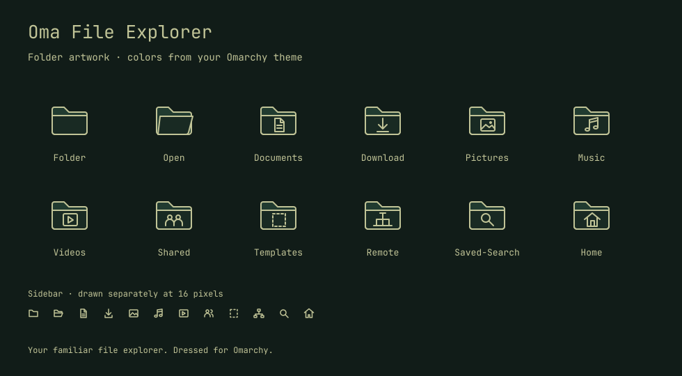

# Oma File Explorer

Make your file explorer match Omarchy, including the folder icons.



Oma File Explorer styles the Files app already installed with Omarchy. Your tabs,
bookmarks, search, previews, shortcuts and file operations stay familiar.

## What it changes

- Backgrounds, sidebar, toolbar, menus and selection colors follow your active theme.
- Monospace text, rounded controls and flat borders bring Files closer to Omarchy's panels.
- Original SVG folder icons include Documents, Downloads, Pictures, Music, Videos,
  shared folders, home and desktop. Separate 16-pixel symbolic drawings keep the
  sidebar legible without squeezing detailed folder badges into tiny icons.
- Theme changes update the stylesheet and icon colors automatically while the shell
  plugin is enabled. The Files extension reloads the stylesheet within two seconds.

The stylesheet loads inside Nautilus only. Existing GTK user styles take precedence.
The icon theme is a desktop setting, so other applications can use the new folders
too. Application and ordinary file icons come from the current Omarchy icon theme.

## Requirements

Omarchy with its Quickshell plugin system, native Nautilus, Python 3.11 or newer,
`nautilus-python`, `python-gobject`, GTK 4.16 or newer and Libadwaita 1.6 or newer.
The initial implementation targets Nautilus 50. Flatpak Nautilus is not supported.

## Try the artwork first

From this repository:

```sh
./bin/oma-file-explorer preview --output /tmp/oma-file-explorer-preview
```

Open `folders.svg` in that directory to see the folder artwork in your current
theme. This exports a stylesheet and icon theme without changing desktop settings.
The output directory must not already exist. Pass `--theme /path/to/theme` to
preview a different directory containing `colors.toml`.

## Install

```sh
omarchy plugin add https://github.com/omas-best/oma-file-explorer.git --enable
```

Omarchy clones and enables the plugin. On first activation it installs the Files
styling extension, applies the current theme and starts automatic updates. The
requirements above must already be installed. No administrator access is needed.

To update later:

```sh
omarchy plugin update community.oma-file-explorer
```

For development from a local checkout, `./install` provides an alternative. It
copies the plugin into the user plugin directory and refuses to overwrite an
existing checkout.

Files must restart once to load the new extension. Finish any transfers first,
quit Files, then use your usual Super+Shift+F shortcut. If Files keeps running in
the background, `nautilus --quit` ends it. The installer never quits it for you.
Subsequent theme changes refresh the running app without restarting it.

## Restore or resume

Run these from the installed plugin directory:

```sh
cd ~/.config/omarchy/plugins/community.oma-file-explorer
./bin/oma-file-explorer restore
./bin/oma-file-explorer apply
./bin/oma-file-explorer status
```

`restore` clears the generated styling, restores the active Omarchy theme's icon
choice and pauses automatic styling. If you've manually selected another icon
theme, restore leaves that choice alone. `apply` resumes styling.

Disabling the shell plugin stops synchronization but leaves the last styling in
place. Run `restore` before removing the plugin:

```sh
./bin/oma-file-explorer restore
omarchy plugin remove community.oma-file-explorer
```

Restore leaves an inactive extension, generated icons and state files for reuse.
It does not delete your configuration or any files in your folders.

## Files it manages

All locations respect the corresponding XDG environment variables.

| Default location | Contents |
| --- | --- |
| `~/.config/omarchy/plugins/community.oma-file-explorer/` | Installed plugin |
| `~/.config/oma-file-explorer/style.css` | Generated Files stylesheet |
| `~/.local/share/nautilus-python/extensions/oma_file_explorer_style.py` | Live stylesheet loader |
| `~/.local/share/icons/OmaFileExplorer/` | Generated icon theme |
| `~/.local/state/oma-file-explorer/` | Restore information and synchronization lock |

The current palette is read from `~/.local/state/omarchy/current/theme/colors.toml`,
with a fallback to the older `~/.config/omarchy/current/theme/` layout. The plugin
checks for changes every three seconds. It writes only changed output and serializes
apply and restore operations. A malformed palette keeps the last generated styling.

## Development

```sh
python3 -m unittest discover -s tests -v
omarchy plugin validate .
```

`templates/style.css` defines the appearance. `oma_file_explorer.py` reads the
palette, draws the SVG folders and handles preview, install and restore.
`extension/oma_file_explorer_style.py` loads the stylesheet in Nautilus.
`Service.qml` runs synchronization while the Omarchy plugin is enabled.

The first version was checked on Nautilus 50.3.1, GTK 4.22.4 and Libadwaita 1.9.3.
Ten automated tests cover theme changes, restore/resume, preservation of existing
styles, conflicting files, icon output, light/dark contrast and preview isolation.
The manifest and QML pass validation, and GTK parses the generated CSS without
diagnostics. An isolated Nautilus session verified the actual shell service,
folder rendering and a live dark-to-light theme change. See the
[dark](assets/files-dark.png) and [light](assets/files-light.png) screenshots.

An additional Quickshell integration test starts the real service with the public
community-plugin manifest, which omits Omarchy's internal source directory. It
also checks paths containing spaces and Unicode and verifies immediate error logging.

Version 0.1.1 fixes service startup after installation through Omarchy. Version
0.1.0 incorrectly relied on a private manifest field, so installed plugins could
be enabled without generating any styles. After updating from 0.1.0, run
`omarchy restart shell` once: the running shell can retain the old QML component
even after a plugin rescan. Then restart Files to load the newly installed
extension, after finishing any transfers.

Nautilus and Libadwaita can change widget selectors between releases. This styles
the existing interface; it does not add views or change how Files manages data.

MIT licensed. Folder artwork is original to this project.
